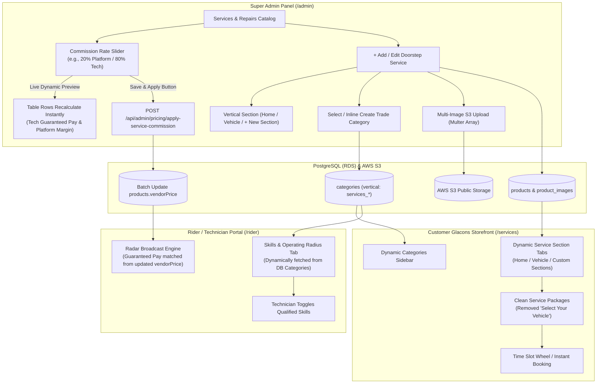

# Glacons Doorstep Services Architecture & Complete Redesign Plan

## 1. Executive Summary & Problem Analysis

Based on our architectural inspection of the codebase and the user-provided screenshots, the current doorstep services catalog suffers from five critical disconnects:

| Current Architecture Bottleneck | Root Cause in Codebase | Required Solution |
| :--- | :--- | :--- |
| **Commission Slider Not Updating Catalog Table** *(New)* | In `ServicesManagementPage.tsx`, moving the commission slider only updates a dummy sample simulator. The catalog table below reads hardcoded static `s.vendorPrice` (e.g., fixed at 30% margin from initial seed). Saving commission only writes to settings and never updates existing services in the database. | Implement a **Live Dynamic Commission Engine**: The table immediately recomputes and reflects the active commission slider in real time. Add **"Save & Apply to All Services"** to batch-update `vendorPrice` across all doorstep services in the database. |
| **Mismatch between Admin & User Catalog** | Glacons storefront (`VerticalServices.tsx`) hardcodes tabs to `'home'` vs `'vehicle'` using title/category string regex. The Admin panel (`ServicesManagementPage.tsx`) has a flat category dropdown with no concept of which section/vertical the service belongs to. | Establish a dynamic **Vertical & Category taxonomy** (`services_home`, `services_vehicle`, `services_<custom>`) allowing Super Admin to assign or create service sections dynamically. |
| **Flawed "Select Your Vehicle" Modal** | `VehicleSelectorModal.tsx` operates client-side with static brand/model arrays. It does not scale package rates, creating a broken expectation for buyers. | **Completely remove the "Select Your Vehicle" modal** and its badge. Model vehicle services as clean, standalone service offerings (e.g., Doorstep Car Spa, Periodic Bike Servicing) with transparent rate cards. |
| **Admin Service Form is Incomplete & Lacks Image Upload** | Super Admin only has a single URL text input for images (`imageUrl`). No multiple image upload, no file dropzone, no bulleted inclusions checklist, and `PUT /api/admin/products/:id` discards images on edit. | Upgrade the service creation modal with **multi-image S3 file uploads** (up to 5 images), drag-and-drop dropzone, inclusions checklist, and fix the backend `PUT` handler to synchronize `product_images`. |
| **Static Technician Skills in Rider Panel** | `RiderProfile.tsx` loads skills from a hardcoded file (`partnerSkills.ts`). Newly created admin categories never appear in the technician roster, preventing technicians from claiming new trades. | Connect `RiderProfile.tsx` dynamically to `/api/categories?vertical=services` so any new category created by Super Admin automatically becomes an activatable technician skill. |

---

## 2. End-to-End System Architecture



---

## 3. Detailed Component-by-Component Implementation Plan

### Phase 1: Dynamic Commission Engine & Catalog Batch Sync

Target Files: `src/admin/pages/ServicesManagementPage.tsx` and `server/routes/admin/pricing.js`

1. **Live Table Recalculation on Slider Movement:**
   - Currently, table rows render:
     ```javascript
     const techPay = s.vendorPrice != null ? s.vendorPrice : Math.round(s.basePrice * 0.7);
     ```
   - Update table computation to be reactive to the active commission rate:
     ```javascript
     const activeCommPct = parseFloat(commissionPct) || 20;
     const techPay = Math.round(s.basePrice * (1 - activeCommPct / 100));
     const margin = s.basePrice - techPay;
     const marginPct = activeCommPct;
     ```
   - As the Super Admin drags the slider from 20% to 15% or 30%, **every row in the table instantly updates its "Technician Guaranteed Pay" and "Platform Margin"** in real time.
2. **"Save & Apply Commission to All Doorstep Services" Backend Action:**
   - Create endpoint: `POST /api/admin/pricing/apply-service-commission`:
     - Saves `service_commission_pct` in system settings.
     - Performs a batch update on all products where `vertical = 'services'`:
       ```javascript
       await prisma.$executeRaw`
         UPDATE products 
         SET "vendorPrice" = ROUND("basePrice" * (1 - ${pct} / 100.0))
         WHERE "fulfillmentType" IN ('hvac', 'hvac_service') OR tags @> ARRAY['doorstep_service'];
       `;
       ```
     - Invalidates pricing cache so order creation, checkout calculations, and technician radar broadcasts immediately reflect the new rate.
   - Frontend button states:
     - Shows **"Save Commission Rate"** and **"Save & Apply to All Services"** with a confirmation prompt ("This will recalculate guaranteed technician payouts across all active doorstep services").

---

### Phase 2: Glacons Customer Storefront Cleanup (`/services`)

Target Files: `src/components/desktop/VerticalServices.tsx` and `src/components/mobile/VerticalServicesMobile.tsx`

1. **Remove "Select Your Vehicle" Subsystem:**
   - Deprecate and remove `<VehicleSelectorModal>` import and usage.
   - Remove the `selectedVehicle` state, `Active Vehicle: Hyundai Creta (Petrol)` pill, and "Change Vehicle" buttons.
   - Clean up `src/components/common/VehicleSelectorModal.tsx`.
2. **Dynamic Section Tabs (Beyond Home & Vehicle):**
   - Replace the static 2-button switcher (`Home Services` vs `Vehicle Services`) with a dynamic section bar queried from database categories:
     - **Home Services** (`services_home` or `services`)
     - **Vehicle Services** (`services_vehicle`)
     - **Custom Super Admin Sections** (`services_<section_slug>`, e.g., Appliance Care, Electronics Repair, Pet Grooming).
   - The selected section automatically filters the category aisle on the left and the package cards on the right.

---

### Phase 3: Super Admin Services & Repairs Redesign (`/admin`)

Target File: `src/admin/pages/ServicesManagementPage.tsx`

#### Multi-Step / Sectional Modal Redesign:
The modal will be structured into four organized tabs/sections:

1. **Classification & Category:**
   - **Service Vertical / Section:** Dropdown with `Home Services`, `Vehicle Services`, and `+ Create New Section`.
   - **Trade Category:** Filtered dynamically by the selected vertical, plus an inline button `[+ Add New Category]` to create categories on the fly without navigating away.
2. **Service Details & Inclusions:**
   - **Service Name** (e.g., *Split AC Deep Jet Foam Servicing & Gas Top-up*).
   - **Service Description** (rich text / textarea).
   - **Key Inclusions / Highlights** (dynamic bullet list: e.g., "Indoor coil foam jet clean", "Outdoor condenser pressure wash", "30-Day revisit warranty").
   - **Estimated Service Duration** (e.g., `45 mins`, `60 mins`, `90 mins`, `2 hours`).
   - **Booking Modes:**
     - `⚡ Instant Match (15–30 Min ETA)`
     - `🗓️ Scheduled Appointment Only`
     - `✨ Both (Instant + Scheduled)`
3. **Multi-Image S3 Upload Engine:**
   - File dropzone accepting multiple files (`PNG`, `JPG`, `WEBP` up to 10MB each).
   - Displays uploaded image thumbnails with:
     - "Main / Cover" badge on the first image.
     - Move left/right to reorder.
     - Remove / Trash icon.
   - Fallback option to input image URLs directly.
4. **Transparent Rate Card & Guaranteed Technician Pay:**
   - **Customer Visit Charge (₹)** (e.g., ₹499).
   - **Platform Commission %** (defaults to global commission setting, e.g., 20%).
   - **Guaranteed Technician Pay (₹)** (automatically calculated: `Charge * (1 - Commission%)` = ₹399, with manual override option).
   - **MRP / Strike-Through Price (₹)** (optional, shows discount badge).

---

### Phase 4: Backend API & Database Fixes

1. **Multi-Image S3 Upload Endpoint:**
   - Add `POST /api/admin/products/upload-images` in `server/routes/admin/products.js` using `multer.memoryStorage()` and `uploadToS3()` from `server/lib/s3.js` (mirroring `vendor/products.js`).
2. **Fix `PUT /api/admin/products/:id` Image Discard Bug:**
   - Update `PUT /api/admin/products/:id` to accept an `images` array of URLs:
     ```javascript
     if (Array.isArray(images)) {
       await prisma.productImage.deleteMany({ where: { productId: id } });
       if (images.length > 0) {
         await prisma.productImage.createMany({
           data: images.map((url, idx) => ({
             productId: id,
             url,
             displayOrder: idx,
           })),
         });
       }
     }
     ```
3. **Category Creation API Extension:**
   - Ensure `POST /api/admin/categories` allows specifying `vertical: 'services_home' | 'services_vehicle' | 'services_<slug>'`.

---

### Phase 5: Rider / Technician Panel Dynamic Skills Sync

Target Files: `src/rider/pages/RiderProfile.tsx` and `server/routes/rider/orders.js`

1. **Dynamic Skills Roster in Rider Profile:**
   - Replace the static `PARTNER_SKILLS` import in `RiderProfile.tsx` with dynamic fetching from `GET /api/categories?vertical=services`.
   - Group the skills by vertical section (`Home Services`, `Vehicle Services`, `Other Trade Services`).
   - Each category in the database immediately appears as a selectable skill badge (with toggle checkbox).
   - When Super Admin creates a new service category, technicians immediately see it and can enable it in their profile.
2. **Radar Order Dispatch Matching:**
   - In `server/routes/rider/orders.js`:
     - Update skill qualification check: match technician's `profile.skills` against:
       - `orderItem.product.categoryId`
       - `orderItem.product.category.slug`
       - `orderItem.product.category.name`
       - Keywords in `product.name` and `product.tags`.
     - This ensures technicians who select a newly created skill category automatically receive the radar broadcast when a customer books a service in that category.

---

## 4. Verification & Testing Matrix

| Scenario | Expected Outcome | Verification Method |
| :--- | :--- | :--- |
| **Commission Slider Drag** | Moving slider from 20% to 25% immediately updates all table rows (Technician Pay & Margin) in real time. | Drag slider in `/admin` Services & Repairs, observe table row numbers. |
| **Save & Apply Commission** | Clicking "Save & Apply to All" persists the setting and batch-updates `vendorPrice` across all doorstep services in DB. | Click button, verify database and refresh page. |
| **Storefront Glacons View** | "Select Your Vehicle" banner and modal are gone. Services are displayed cleanly under dynamic section tabs. | Browser preview of `/services` on desktop and mobile. |
| **Super Admin Create Service** | Modal allows selecting section (Home/Vehicle/New), category, inclusions, and uploading multiple images directly to S3. | Open modal on `/admin` Services & Repairs, upload 3 images, save service. |
| **Super Admin Edit Service** | Editing a service properly persists updated multi-images and rate card. | Edit existing service, add 1 image, verify changes in database and storefront. |
| **New Category Creation** | Admin creates a new category (e.g. *Appliance Repair*); it appears in storefront tabs and rider skills immediately. | Create category in modal, inspect storefront sidebar and rider profile. |
| **Technician Skills Sync** | Technician visits `Skills & Radius` tab in `/rider`, sees all dynamic categories, and can toggle them. | Check `/rider` profile -> Skills & Radius tab. |
| **Radar Job Dispatch** | Booking an order for the new category broadcasts only to qualified technicians within radius. | Simulate service booking and inspect rider radar feed. |

---

## 5. Implementation Roadmap

1. **Step 1:** Implement Dynamic Commission Engine (reactive table recalculation on slider movement + `POST /api/admin/pricing/apply-service-commission` batch update).
2. **Step 2:** Backend endpoints (`upload-images` and `PUT` image sync fix in `server/routes/admin/products.js`).
3. **Step 3:** Redesign `ServicesManagementPage.tsx` modal (sections, dynamic category creation, multi-image S3 dropzone, inclusions checklist).
4. **Step 4:** Clean up Glacons user storefront (`VerticalServices.tsx` and `VerticalServicesMobile.tsx`), removing vehicle selector and introducing dynamic section tabs.
5. **Step 5:** Connect `RiderProfile.tsx` and `orders.js` to dynamic categories for technician skill qualification.
6. **Step 6:** Build verification, git push to `main`, EC2 deployment, and live end-to-end testing.
