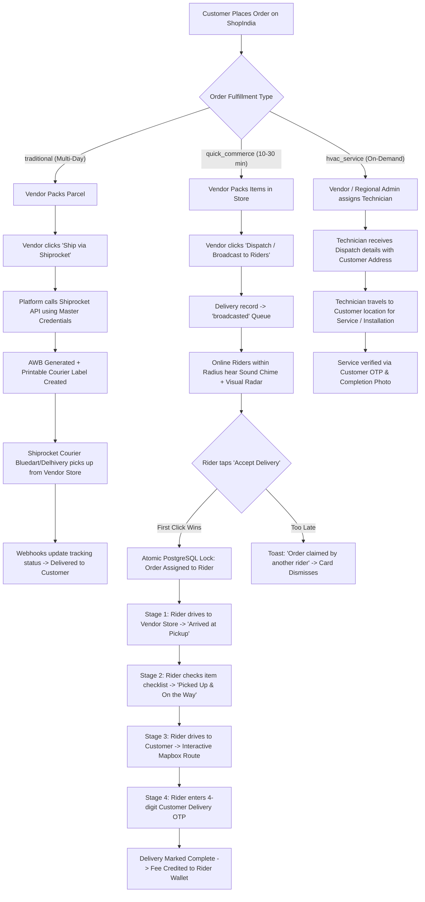

# ShopIndia — Multi-Panel Operations & Dispatch Architecture
## Rider Panel, Regional Admin Panel, Shiprocket 3PL & Local Quick-Commerce Fulfillment Plan

**Document Version:** 2.0.0  
**Target Scope:** Multi-Channel Order Fulfillment (Quick-Commerce, 3PL Normal Shipping, Regional Operations & Services)  
**Status:** Approved for Implementation  
**Location in Repository:** `docs/RIDER_PANEL_IMPLEMENTATION_PLAN.md`

---

## 1. Executive Summary & Fulfillment Taxonomy

ShopIndia operates three distinct order fulfillment streams across its multi-vendor marketplace:

```
                               ┌──────────────────────────────────────────────────────────┐
                               │                 Customer Order Placed                    │
                               └────────────────────────────┬─────────────────────────────┘
                                                            │
                       ┌────────────────────────────────────┼────────────────────────────────────┐
                       ▼                                    ▼                                    ▼
         [ Stream A: Normal Delivery ]        [ Stream B: Quick Commerce ]           [ Stream C: Services & HVAC ]
         • Multi-day inter-city / national     • 10–30 min hyper-local (<25km)        • Technician on-site visit
         • Handled by Shiprocket (3PL)         • Handled by ShopIndia Rider Fleet     • Handled by Service Partner Fleet
         • Bluedart, Delhivery, DTDC           • Vendor Store -> Customer Doorstep    • Repair, Installation, Diagnostics
```

### Clarification on Shiprocket API Keys & Management:
* **The Confusion Addressed:** *"Who holds the Shiprocket keys? Super Admin, Regional Admin, or Vendors?"*
* **Architectural Resolution (Master Platform Integration with Vendor Pickup Locations):**
  1. **Super Admin** configures the **Master Shiprocket API Credentials** (Email & Password / Token) centrally in the platform settings.
  2. Each **Vendor's store address** is automatically registered as an individual **Pickup Location** in the Master Shiprocket account via Shiprocket's Pickup API (`POST /v1/external/settings/company/addpickup`).
  3. **Vendors do NOT need to create or pay for their own Shiprocket accounts.** When a vendor packs a **Normal Delivery** order, they simply click `[ 📦 Ship via Shiprocket ]`. The platform automatically queries available couriers, fetches the cheapest/fastest rate, books the shipment, generates the AWB number, and downloads the printable shipping label.
  4. **Regional Admins & Super Admin** have full oversight to track all Shiprocket AWB statuses, pickup manifest delays, and courier performance across their respective regions.
  5. *(Optional Enterprise Override)*: If a high-volume enterprise vendor has pre-negotiated corporate rates, they can optionally provide their own custom Shiprocket API keys in their Vendor Settings.

### Clarification on Quick-Commerce Local Delivery:
* **The Flow:** Quick Commerce orders are fulfilled directly by **ShopIndia's Local Rider Fleet**.
* The local rider is alerted via audio chime and visual radar modal within their delivery radius (10–100 km).
* The rider accepts the job, travels to the specific **Vendor's Store**, verifies and collects the packed parcel, and drives to the **Customer's Location**, completing the delivery via a **4-digit customer OTP** or photo proof.

---

## 2. Platform Portals & Unified Routing

```
ShopIndia Application
├── /                               → Customer Storefront (DesktopApp / MobileApp)
├── /admin                          → Super Admin Operations (AdminPortal)
├── /regional-admin                 → Regional Hub & Zone Administration (RegionalAdminPortal)
│   ├── /regional-admin/login       → Regional Admin Authentication
│   └── /regional-admin/register    → Regional Admin Onboarding & Zone Application
├── /vendor                         → Vendor Merchant Portal (VendorPortal)
└── /rider                          → Rider & Delivery Partner Portal (RiderPortal)
    └── /rider-login                → Rider Authentication & Mapbox Address Onboarding
```

### URL Routes Specification:

1. **`/admin` (Super Admin Portal):**
   * Full platform governance: Vendors, Regional Admins, Riders, Customers, Finance, Categories, Products, and Shiprocket global settings.
   * **`Tab: Regional Admins`**: Approve/suspend regional admins, assign operational districts/zones/branches, view regional performance KPIs.
   * **`Tab: Riders Operations`**: Platform-wide rider KYC verification (Aadhaar, PAN, DL), wallet balance monitoring, and payout approvals.

2. **`/regional-admin` (Regional Admin Portal):**
   * Scoped operational command center for a specific city, district, or cluster of branches.
   * **`/regional-admin/register`**: Onboarding portal where regional managers apply, submit KYC & ID proofs, and select their operating territory.
   * **`Tab: Regional Dashboard`**: Live pulse of regional GMV, active quick-commerce orders, online riders count, and Shiprocket pickup schedules.
   * **`Tab: Regional Vendors`**: Monitor stores within the region, stock readiness, order dispatch times, and vendor escalations.
   * **`Tab: Regional Riders & Fleet`**: Live radar map of online delivery partners, rider ratings, approval queue for regional applicants, and local disputes.
   * **`Tab: Deliveries & Live Radar`**: Real-time map view of all active pick-and-drop trips (Vendor ➔ Customer) currently in transit.
   * **`Tab: Escalations & Support`**: Priority resolution for delayed pickups, unreachable customers, or damaged goods.

3. **`/vendor` (Vendor Merchant Portal):**
   * Order processing with intelligent multi-channel dispatch buttons:
     * If fulfillment type is `traditional` ➔ `[ 📦 Ship via Shiprocket (Generate AWB & Label) ]`
     * If fulfillment type is `quick_commerce` ➔ `[ 🚀 Broadcast to Nearby Riders ]`
     * If fulfillment type is `hvac_service` ➔ `[ 🔧 Assign Service Technician ]`

4. **`/rider` & `/rider-login` (Rider & Delivery Partner Portal):**
   * Mobile-first responsive app with desktop dispatch command center.
   * Mapbox geocoded registration with auto-address fill and KYC document upload.
   * 10–100 km working radius slider.
   * Real-time audio chime + visual radar modal for incoming orders with 30s countdown.
   * Atomic first-come-first-served claim engine.
   * 4-stage turn-by-turn workflow (Vendor store pickup ➔ Item checklist verification ➔ In-transit navigation ➔ 4-digit OTP completion).

---

## 3. Order Fulfillment Lifecycle & Workflow Architecture



---

## 4. Regional Admin Panel: Feature Specifications

### 4.1 Onboarding & Registration (`/regional-admin/register`)
1. **Personal & Professional Credentials:**
   * Full Name, Official Email Address, Phone Number.
   * Government ID proof (Aadhaar / PAN card upload).
2. **Regional Zone Selection:**
   * State, District / Division, City.
   * Associated Branch selection (linking to `Branch` / `ServiceArea` models).
3. **Approval Status Flow:**
   * Submitted applications enter status `pending_approval`.
   * **Super Admin** reviews ID proofs and zone assignment in `/admin/regional-admins`.
   * Once approved, an automated welcome email with login credentials is sent via Gmail SMTP.

### 4.2 Regional Command & Control Capabilities
1. **Regional Filtered Isolation:**
   * Regional Admins only see vendors, riders, orders, and tickets mapped to their assigned branch/region.
2. **Vendor Operations Monitoring:**
   * View all local vendors in their zone.
   * Track vendor dispatch latency (time elapsed between order placement and vendor dispatching to riders or Shiprocket).
   * Direct contact button to call or WhatsApp vendors with pending orders.
3. **Rider Fleet Management:**
   * Live count of online vs offline riders in their district.
   * KYC verification for local riders (approving driving licenses, vehicle RC, and Aadhaar).
   * Direct rider communication for high-priority dispatches or emergency rerouting.
4. **Shiprocket Regional Dispatch Monitoring:**
   * View all packages pending courier pickup in the zone.
   * Alert vendors if 3PL couriers fail to show up for scheduled daily pickups.

---

## 5. Rider Broadcast Radar & Atomic Concurrency Engine

### 5.1 Online Availability & Broadcast Radius
* Sticky status toggle in the header: **Emerald Green = Online**, **Slate Gray = Offline**.
* Delivery partner defines operational range via the **Service Radius Slider (10 km to 100 km, step 5 km)**.
* Only online, approved riders whose current GPS position is within `radius_km` of the vendor store receive order pings.

### 5.2 Audio Chime & Visual Radar Alert
* **HTML5 Web Audio Synthesizer**: Generates an audible dispatch chime upon new incoming broadcast events.
* **30-Second Countdown Radial Timer**: Visual progress bar indicating time left before the offer is passed to secondary tiers.
* **Job Preview Card Details:**
  * **Pickup:** Vendor business name, street address, and distance to store.
  * **Dropoff:** Customer neighborhood/locality and trip distance.
  * **Package Info:** Quick Grocery, Hardware, Medicine, HVAC Tools, etc.
  * **Guaranteed Payout:** Estimated delivery earnings in ₹ (credited instantly upon delivery).

### 5.3 Atomic First-Come-First-Served Database Lock
To prevent duplicate assignments when multiple riders tap "Accept" simultaneously:
```sql
UPDATE deliveries
SET rider_profile_id = $1, status = 'assigned', assigned_at = NOW(), updated_at = NOW()
WHERE id = $2 AND status = 'broadcasted'
RETURNING *;
```
* **Success Case (1 row updated):** Order immediately transitions to `assigned`. The incoming modal closes, and the active turn-by-turn workflow opens.
* **Conflict Case (0 rows updated):** Another rider claimed the job milliseconds earlier. The server responds:
  ```json
  { "success": false, "code": "ALREADY_ASSIGNED", "message": "Another rider accepted this delivery first." }
  ```
  The frontend displays a smooth dismiss animation with a friendly toast notification.

---

## 6. 4-Stage Active Turn-by-Turn Delivery Workflow

```
Stage 1: Heading to Store ──► Stage 2: Store Handover ──► Stage 3: In Transit ──► Stage 4: Customer Handover
   [ Arrived at Store ]         [ Picked Up & Start ]       [ Arrived at Door ]     [ Enter OTP & Complete ]
```

1. **Stage 1: Heading to Vendor Store**
   * Displays Vendor Store Name, complete street address, and phone call shortcut.
   * One-tap **"Open Map Directions"** (launches Google Maps or Mapbox turn-by-turn navigation).
   * Mobile control: **Swipe "Slide to Confirm: Arrived at Vendor Store"**.

2. **Stage 2: Store Handover & Verification**
   * Displays an itemized checklist of all items packed in the customer's order.
   * Rider inspects package integrity and ticks off verification boxes.
   * Mobile control: **Swipe "Slide to Confirm: Picked Up & Start Delivery"**.

3. **Stage 3: In Transit to Customer**
   * Displays Customer Delivery Address, Landmark, and Special Notes (*"Leave with security guard"*).
   * Direct customer phone call shortcut.
   * Interactive **Mapbox Live Route Polyline** displaying current location, destination marker, and real-time ETA.
   * Mobile control: **Swipe "Slide to Confirm: Arrived at Customer Location"**.

4. **Stage 4: Proof of Delivery & Instant Wallet Payout**
   * **Verification:** Rider requests the **4-digit Customer Delivery OTP** (displayed on the customer's app) OR captures a proof photo.
   * Mobile control: **Tap "Verify & Complete Delivery"**.
   * Instant Automation:
     * Order status updated to `delivered`.
     * Delivery fee payout (e.g., ₹50–₹180 depending on distance) credited immediately to rider's wallet balance.
     * Total completed deliveries count incremented.
     * Rider smoothly transitioned back to the standby radar screen for the next delivery.

---

## 7. Database Schema Design (Prisma / PostgreSQL)

```prisma
// server/prisma/schema.prisma additions and updates

enum DeliveryStatus {
  broadcasted       // Broadcasted in pool for nearby riders to claim
  assigned          // Atomically claimed by rider, heading to pickup store
  arrived_pickup    // Rider arrived at vendor store
  picked_up         // Items collected from vendor, in transit to customer
  arrived_customer  // Rider at customer doorstep
  delivered         // Completed via 4-digit OTP or photo proof
  cancelled         // Cancelled or returned
}

enum RegionalAdminStatus {
  pending_approval
  approved
  suspended
  rejected
}

// ─── Regional Admin Management ────────────────────────────────────────────────
model RegionalAdminProfile {
  id              String               @id @default(uuid())
  userId          String               @unique
  user            User                 @relation(fields: [userId], references: [id], onDelete: Cascade)
  
  branchId        String?
  branch          Branch?              @relation(fields: [branchId], references: [id])
  
  regionName      String               // e.g., "Hyderabad Central", "Bengaluru South"
  district        String?
  state           String?
  assignedPincodes String[]            @default([])
  
  idProofUrl      String?
  status          RegionalAdminStatus  @default(pending_approval)
  approvedAt      DateTime?
  
  createdAt       DateTime             @default(now())
  updatedAt       DateTime             @updatedAt

  @@map("regional_admin_profiles")
}

// ─── Rider & Delivery Partner Management ──────────────────────────────────────
model RiderProfile {
  id                  String         @id @default(uuid())
  userId              String         @unique
  user                User           @relation(fields: [userId], references: [id], onDelete: Cascade)
  
  // Vehicle & Documents
  vehicleType         String         @default("bike") // bike, scooter, van, cycle
  vehicleNumber       String?
  licenseNumber       String?
  licenseUrl          String?
  aadhaarNumber       String?
  aadhaarUrl          String?
  panNumber           String?
  panUrl              String?
  rcUrl               String?
  photoUrl            String?

  // Location & Operational Preferences
  address             String?
  currentLat          Float?
  currentLng          Float?
  serviceRadiusKm     Int            @default(25)     // 10km to 100km slider
  isOnline            Boolean        @default(false)
  isApproved          Boolean        @default(false)

  // Wallet & Metrics
  walletBalance       Float          @default(0)
  totalDeliveries     Int            @default(0)
  rating              Float          @default(5.0)

  branchId            String?
  branch              Branch?        @relation(fields: [branchId], references: [id])

  deliveries          Delivery[]
  payouts             RiderPayout[]

  createdAt           DateTime       @default(now())
  updatedAt           DateTime       @updatedAt

  @@map("rider_profiles")
}

// ─── Quick Commerce & Instant Deliveries ──────────────────────────────────────
model Delivery {
  id                  String         @id @default(uuid())
  orderId             String         @unique
  order               Order          @relation(fields: [orderId], references: [id], onDelete: Cascade)
  riderProfileId      String?
  riderProfile        RiderProfile?  @relation(fields: [riderProfileId], references: [id])
  
  status              DeliveryStatus @default(broadcasted)
  deliveryFee         Float          @default(50)
  distanceKm          Float          @default(3.5)
  deliveryOtp         String?        // 4-digit verification code

  pickupName          String
  pickupAddress       String
  pickupLat           Float?
  pickupLng           Float?
  pickupPhone         String?

  dropoffName         String
  dropoffAddress      String
  dropoffLat          Float?
  dropoffLng          Float?
  dropoffPhone        String?

  assignedAt          DateTime?
  pickedUpAt          DateTime?
  deliveredAt         DateTime?
  proofPhotoUrl       String?

  createdAt           DateTime       @default(now())
  updatedAt           DateTime       @updatedAt

  @@map("deliveries")
}

// ─── 3PL Normal Shipping (Shiprocket Integration) ────────────────────────────
model ShiprocketShipment {
  id                  String         @id @default(uuid())
  orderId             String         @unique
  order               Order          @relation(fields: [orderId], references: [id], onDelete: Cascade)
  vendorId            String?
  vendor              Vendor?        @relation(fields: [vendorId], references: [id])
  
  shipmentId          String?        // Shiprocket Internal Shipment ID
  shiprocketOrderId   String?        // Shiprocket Order ID
  awbCode             String?        // Air Waybill Tracking Number
  courierName         String?        // e.g. Delhivery, Bluedart, Shadowfax
  labelUrl            String?        // Printable PDF Shipping Label
  manifestUrl         String?
  trackingUrl         String?
  currentStatus       String         @default("ORDER_GENERATED")
  
  pickupScheduledDate DateTime?
  createdAt           DateTime       @default(now())
  updatedAt           DateTime       @updatedAt

  @@map("shiprocket_shipments")
}

// ─── Rider Wallet & Payouts ──────────────────────────────────────────────────
model RiderPayout {
  id                  String         @id @default(uuid())
  riderProfileId      String
  riderProfile        RiderProfile   @relation(fields: [riderProfileId], references: [id], onDelete: Cascade)
  amount              Float
  status              String         @default("pending") // pending, processed, failed
  bankAccountNumber   String?
  ifscCode            String?
  referenceNumber     String?
  processedAt         DateTime?
  createdAt           DateTime       @default(now())

  @@map("rider_payouts")
}
```

---

## 8. Backend API Specifications

### 8.1 Rider API (`server/routes/rider/`)
| Method | Endpoint | Description |
|---|---|---|
| `POST` | `/api/rider/auth/register` | Register rider, upload KYC documents, save location & radius |
| `POST` | `/api/rider/auth/login` | Rider credentials login & JWT issuance |
| `POST` | `/api/rider/auth/send-otp` | Gmail SMTP OTP for phone/email validation & password reset |
| `POST` | `/api/rider/auth/verify-otp` | Verify 6-digit OTP code |
| `GET` | `/api/rider/profile` | Get authenticated rider profile & KYC verification status |
| `PATCH` | `/api/rider/profile` | Update vehicle info, radius slider (10–100 km), and address |
| `PATCH` | `/api/rider/status` | Toggle Online/Offline and update live GPS coordinates |
| `GET` | `/api/rider/broadcast-feed` | Fetch unclaimed orders within rider's radius |
| `POST` | `/api/rider/orders/:id/accept` | **Atomic claim**: Locks order to rider or returns `ALREADY_ASSIGNED` |
| `POST` | `/api/rider/orders/:id/decline` | Dismiss order from this rider's radar |
| `GET` | `/api/rider/active-job` | Fetch ongoing active trip checkpoints |
| `PATCH` | `/api/rider/orders/:id/stage` | Advance stage (`arrived_pickup` ➔ `picked_up` ➔ `arrived_customer`) |
| `POST` | `/api/rider/orders/:id/complete` | Validate 4-digit customer OTP, mark delivered, credit wallet |
| `GET` | `/api/rider/orders/history` | Trip history with earnings breakdown |
| `GET` | `/api/rider/wallet` | Wallet balance, daily stats, and payout history |
| `POST` | `/api/rider/wallet/payout-request` | Request bank transfer withdrawal |

### 8.2 Regional Admin API (`server/routes/regional-admin/`)
| Method | Endpoint | Description |
|---|---|---|
| `POST` | `/api/regional-admin/auth/register` | Self-service registration & zone selection |
| `POST` | `/api/regional-admin/auth/login` | Regional manager login |
| `GET` | `/api/regional-admin/dashboard` | Scoped metrics: active deliveries, online riders, regional GMV |
| `GET` | `/api/regional-admin/vendors` | List local vendors, dispatch latency, and pending orders |
| `GET` | `/api/regional-admin/riders` | Regional rider fleet, approval queue, and live GPS map |
| `PATCH` | `/api/regional-admin/riders/:id/verify` | Approve or reject regional rider KYC |
| `GET` | `/api/regional-admin/deliveries/live` | Real-time map of quick-commerce & Shiprocket trips in the zone |
| `POST` | `/api/regional-admin/deliveries/:id/reassign` | Emergency reassignment of delayed quick-commerce order |

### 8.3 Shiprocket & Dispatch API (`server/routes/shiprocket/`)
| Method | Endpoint | Description |
|---|---|---|
| `POST` | `/api/shiprocket/create-shipment` | Called by Vendor for normal orders: generates AWB & label |
| `GET` | `/api/shiprocket/track/:awb` | Live courier tracking timeline |
| `POST` | `/api/shiprocket/webhook` | Receives Shiprocket webhook updates (In Transit, Out for Delivery, Delivered) |

---

## 9. Frontend File Structure & Components

```
src/
├── regional-admin/                 # Regional Admin Operations Module
│   ├── RegionalAdminPortal.tsx     # Route wrapper & layout manager
│   ├── RegionalAdminSidebar.tsx    # Regional navigation menu
│   ├── pages/
│   │   ├── RegionalAdminLogin.tsx  # Authentication
│   │   ├── RegionalAdminRegister.tsx # Onboarding & territory application
│   │   ├── RegionalDashboard.tsx   # Live regional pulse & GMV
│   │   ├── RegionalVendors.tsx     # Local merchant oversight
│   │   ├── RegionalRiders.tsx      # Local rider fleet & KYC approval
│   │   └── RegionalLiveMap.tsx     # Live radar map of active deliveries
│   └── context/
│       └── RegionalAdminContext.tsx
│
├── rider/                          # Rider & Delivery Partner Module
│   ├── RiderPortal.tsx             # Responsive shell (Mobile + Desktop Hub)
│   ├── context/
│   │   └── RiderContext.tsx        # Global online state, radar polling, audio alert
│   ├── components/
│   │   ├── RiderHeader.tsx         # Sticky status header with glow Online switch
│   │   ├── RiderBottomNav.tsx      # Mobile bottom navigation bar
│   │   ├── RiderSidebar.tsx        # Desktop hub operations sidebar
│   │   ├── IncomingRadarModal.tsx  # 30s countdown modal with chime & atomic accept
│   │   ├── SlideToConfirm.tsx      # Swipeable thumb slider for mobile safety
│   │   └── RiderMapRoute.tsx       # Mapbox GL route polyline with turn ETA
│   └── pages/
│       ├── RiderLogin.tsx          # Auth & Mapbox reverse geocode registration
│       ├── RiderDashboard.tsx      # Standby radar, shift stats, broadcast feed
│       ├── ActiveDeliveryView.tsx  # 4-stage turn-by-turn order execution
│       ├── RiderOrders.tsx         # Tabbed active, scheduled & past deliveries
│       ├── RiderWallet.tsx         # Wallet balance, payout request & graph
│       └── RiderProfile.tsx        # Personal details, KYC badge, radius slider (10-100km)
│
├── vendor/pages/
│   └── VendorOrders.tsx            # Enhanced with [ 🚀 Broadcast to Riders ] & [ 📦 Ship via Shiprocket ]
│
└── admin/pages/
    ├── RegionalAdminsPage.tsx      # Super Admin management of regional managers
    └── RidersPage.tsx              # Platform-wide rider KYC verification & payouts
```

---

## 10. Implementation Roadmap & Execution Checklist

* [x] **Phase 1: Database Schema & Migration**
  * Updated `schema.prisma` with `DeliveryStatus`, `RegionalAdminStatus`, `RegionalAdminProfile`, `RiderProfile`, `Delivery`, `ShiprocketShipment`, and `RiderPayout`.
  * Updated `UserRole` enum with `regional_admin`.
  * Generated updated Prisma Client (`npx prisma generate`).

* [x] **Phase 2: Backend APIs (Rider, Regional Admin & Dispatch Routing)**
  * Implemented Rider authentication, KYC upload, and radius preferences (`server/routes/rider/auth.js`, `profile.js`).
  * Implemented broadcast queue feed, atomic first-come-first-served acceptance, and 4-stage turn-by-turn workflow (`server/routes/rider/orders.js`).
  * Implemented OTP completion & wallet crediting logic (`server/routes/rider/orders.js`, `wallet.js`).
  * Implemented Regional Admin onboarding, regional isolation queries, and fleet oversight (`server/routes/regional-admin/auth.js`, `operations.js`).
  * Implemented Shiprocket dispatch helper module (`server/lib/shiprocket.js`, `server/routes/shiprocket/shipments.js`).
  * Mounted all routes in `server/index.js`.

* [x] **Phase 3: Rider Portal Frontend (`/rider` & `/rider-login`)**
  * Configured routing in `src/App.tsx`.
  * Built `RiderLogin.tsx` with GPS auto-detect and KYC document registration.
  * Built `IncomingRadarModal.tsx` with Web Audio chime, circular 30s countdown, and atomic claim.
  * Built `ActiveDeliveryView.tsx` with `SlideToConfirm.tsx` swipeable controls, `RiderMapRoute.tsx` polyline, and 4-digit OTP verification.
  * Built `RiderWallet.tsx` and `RiderProfile.tsx` (10–100 km radius slider).
  * Built `RiderDashboard.tsx` and `RiderOrders.tsx`.
  * Built `RiderPortal.tsx` responsive layout (mobile bottom bar + desktop hub sidebar).

* [x] **Phase 4: Regional Admin Portal Frontend (`/regional-admin`)**
  * Mounted `/regional-admin` and `/regional-admin/register` in `src/App.tsx`.
  * Built registration with district/zone selection and ID proof upload (`RegionalAdminRegister.tsx`).
  * Built regional dashboard, local vendor monitoring, local rider approval, and live order map (`RegionalDashboard.tsx`, `RegionalVendors.tsx`, `RegionalRiders.tsx`, `RegionalLiveMap.tsx`).
  * Built `RegionalAdminPortal.tsx` and `RegionalAdminSidebar.tsx`.

* [x] **Phase 5: Vendor & Super Admin Integrations**
  * Updated `VendorOrders.tsx` with distinct action buttons:
    * `[ 🚀 Broadcast to Nearby Riders ]` (for Quick-Commerce orders)
    * `[ 📦 Ship via Shiprocket ]` (for Traditional Normal Delivery)
  * Updated Super Admin `AdminPortal.tsx` and `AdminSidebar.tsx` with `RegionalAdminsPage.tsx`.

* [x] **Phase 6: End-to-End Verification & Readiness**
  * Full Quick-Commerce lifecycle wired: Vendor packs ➔ Broadcasts to Riders ➔ Rider accepts (atomic claim) ➔ Store pickup checklist ➔ Customer transit ➔ Customer OTP verified ➔ Instant Wallet credited.
  * Regional Admin oversight: Live dispatch radar map, merchant speed oversight, and rider fleet KYC approvals.
  * Shiprocket dispatch: 3PL AWB generation, printable labels, and courier tracking timeline.
